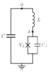

# VecWire

VecWire draws electrical circuit schematics as SVG, with circuit-QED figures as
the first use case. The schematic is generated from code and stays editable
afterwards: each component becomes a named SVG group, the same script writes
byte-identical SVG, and the output opens in Inkscape.

<p align="center">
  
</p>

<p align="center"><sub>A circuit-QED schematic with labels typeset by VecTeX, from <code>examples/fig1a_cqed.py --tex</code>.</sub></p>

The symbol set covers wires, capacitors, inductors, Josephson junctions (the
bare X, boxed harmonic junctions, and multiharmonic junctions), ground symbols,
connection nodes, dashed enclosures, and labels. Components connect named,
positioned nodes and draw their own leads.

VecWire is pre-alpha: a first version, not yet on PyPI, with an API that will
change.

## Install

VecWire is not on PyPI yet. Install it from GitHub (Python 3.12 or newer):

```bash
python -m pip install "vecwire @ git+https://github.com/maiani/vecwire"
```

The only runtime dependency is lxml. For labels typeset by TeX, install the
optional VecTeX extra; VecTeX also needs `pdflatex` and `dvisvgm` on `PATH`:

```bash
python -m pip install -e '/path/to/vecwire[tex]'
```

## Quick start

A capacitively shunted Josephson junction, grounded at the bottom:

```python
from vecwire import Circuit

circuit = Circuit(70, 96)
circuit.row(14, top_left=18, phi=35, top_right=52, dots={"phi"})
circuit.row(78, bottom_left=18, gnd=35, bottom_right=52)

circuit.wire("top_left", "phi", "top_right")
circuit.wire("bottom_left", "gnd", "bottom_right")
circuit.capacitor("top_left", "bottom_left", id="C")
circuit.junction("top_right", "bottom_right", id="JJ")
circuit.ground("gnd", id="ground")

circuit.label("C", (11, 46), anchor="rc")
circuit.label("φ", "phi", offset=(0, -3), anchor="cb")
circuit.write_svg("transmon.svg")
```

Coordinates are SVG user units, points by default (`Circuit(..., unit="pt")`;
`"px"` and `"mm"` are also accepted). `to_svg_document()` returns the same
document as a string.

## Examples

```bash
python examples/fig1a_cqed.py              # writes examples/output/fig1a.svg
python examples/fig1a_cqed.py --tex        # editable TeX labels through Vectex
python examples/harmonic_junctions.py      # the junction symbol legend
```

`fig1a_cqed.py` draws a shunt capacitance `C` across an inductor `L` in series
with a parallel junction branch of `V_J` and `C_J`, marking the node phases `φ`
and `δ`. `harmonic_junctions.py` draws the bare X beside the boxed
`m = 1, 2, 3` and `sin` symbols, and an inductor in series with a sinusoidal
junction next to the multiharmonic junction it acts like. Both previews are
checked in: [fig1a.svg](examples/fig1a.svg) and
[harmonic_junctions.svg](examples/harmonic_junctions.svg). Without `--tex`
the examples use plain SVG text and need no TeX installation.

## Nodes and wires

A `Node` is a placed connection point, and wires join nodes into an electrical
net. `row()` and `column()` declare several nodes sharing one coordinate;
`nodes()` takes arbitrary positions. None of them draws anything. Methods
accept node names or the `Node` values these calls return.

A wire visits its nodes in the order given and may pass through several of
them; a route that doubles back is rejected. Crossing or overlapping in the
drawing does not make a connection. Optional `via` points shape a route without
adding connections:

```python
circuit.wire("left", "right", via=((18, 30), (52, 30)), corner_radius=2)
```

Each routed wire is one SVG path, so `linejoin="round"` softens a bend and
`corner_radius` curves the centerline; both can be set on the `Circuit` or per
wire. A route still passes exactly through every named node it visits, even
with a corner radius. Two-terminal symbols are placed horizontally or
vertically.

Labels take plain text or a VecTeX fragment; a fragment's SVG group is embedded
as is, so it stays editable through TexText.

The `Circuit` records drawing geometry only. It does not infer electrical
topology or compute circuit parameters; those belong to the scientific model
that produces the figure.

Plain-text labels accept `font_family` and `size` (in the circuit's user units):

```python
circuit.label("Capacitance", (40, 20), size=8, font_family="TeX Gyre Heros")
```

Omitting `font_family` preserves inherited SVG typography. For fragment labels,
choose typography when rendering the fragment; these text options do not
rescale or replace its glyphs.

## Josephson junctions

`junction()` draws the bare X, the standard Josephson-junction symbol, which
leaves the current-phase relation unspecified; its leads meet at the centre of
the X, so the wire runs through it. `harmonic_junction()` draws the boxed
symbol of one tunnelling harmonic: its square holds `order` crossed diagonals
each way for a `cos(mφ)` term, in which `m` Cooper pairs tunnel together, and
`kind="sin"` adds two dots for the odd `sin(mφ)` term of a φ0 junction. The
`m = 1` box is the bare X inside its square, so the two symbols line up. In
both, `color` sets the glyph and `lead_color` keeps the leads in the circuit
ink.

```python
circuit.junction("top", "bottom", id="JJ")  # bare X
circuit.harmonic_junction("top", "bottom", 2, color="#8075c1", lead_color="#262626")
circuit.harmonic_junction("top", "bottom", kind="sin")  # sin φ, m = 1
```

Both groups carry `data-component="josephson-junction"`; the boxed one also
records `data-harmonic` and `data-kind`, so a stylesheet or selector can tell
them apart.

`harmonic_sum()` draws a multiharmonic junction: a dashed box holding
`⊠ + ⊠⊠ + ⊠⊠⊠ + ⋯` between two terminals. The harmonics of one junction add as
energies, so the terms hang in parallel between two rails, which the branch
leads join at the centre of the box. `rails=False` ends each term in terminal
dots instead, a shorthand notation. The sum reads left to right on a vertical
branch and top to bottom on a horizontal one. `colors` and `kinds` set each
term, and `ellipsis=False` drops the trailing `+ ⋯`.

`box()` draws a dashed enclosure around a subcircuit that acts as one element;
it is decoration only and creates no connection. Both return a `Box` with the
bounds: `Box.at("rb")` uses the label anchors, and `Box.terms` holds the
centres of the summed glyphs for per-term labels:

```python
box = circuit.harmonic_sum("top", "bottom", (1, 2, 3), colors=shades)
for order, centre in zip((1, 2, 3), box.terms):
    circuit.label(f"E{order}", (centre[0], box.bottom + 2), anchor="ct")
circuit.box((10, 18), (60, 95), id="effective-junction")
```

## Architecture

| Module | Contents |
| --- | --- |
| `vecwire.core` | `Circuit`: the SVG root and unique ids, nodes, wire routing, labels, `box()`, `to_svg_document()`, and the drawing API symbols are built from |
| `vecwire.elements` | the symbol library: `capacitor`, `inductor`, `junction`, `harmonic_junction`, `harmonic_glyph`, `harmonic_sum`, `ground` |
| `vecwire.geometry` | value types and checks shared by both: `Point`, `Box`, `Branch`, `positive`, `offset`, … |
| `vecwire.node` | `Node`, a named, placed connection point |

A symbol is a plain function whose first argument is the circuit, and it draws
only through the public drawing API: `circuit.branch(start, end)` resolves the
terminals into a `Branch`, `circuit.group(kind, id, branch=...)` opens a
semantic group with `data-from`/`data-to`, and `line`, `rect`, `dot`, and
`path` add strokes in the circuit ink. Symbols are written in branch
coordinates (`branch.at(along, across)`), so one definition serves every
orientation. A new symbol is a new function, in `vecwire.elements` or your own
script, with no change to the core:

```python
def resistor(circuit, start, end, *, id=None):
    branch = circuit.branch(start, end)
    group = circuit.group("resistor", id, branch=branch)
    lead, step = branch.length / 4, branch.length / 12
    points = [branch.at(lead + (i + 0.5) * step, 3 * (-1) ** i) for i in range(6)]
    circuit.path(
        group,
        [
            ("M", *branch.start.position),
            ("L", *branch.at(lead)),
            *(("L", *p) for p in points),
            ("L", *branch.at(3 * lead)),
            ("L", *branch.end.position),
        ],
    )


resistor(circuit, "top", "bottom", id="R")
```

The built-in symbols are also `Circuit` methods, bound by one class attribute
each (`capacitor = elements.capacitor`), so `circuit.capacitor(a, b)` is the
same call as `elements.capacitor(circuit, a, b)`, with the same signature and
docstring. There is no registry or plugin hook. The core imports the library
for these bindings, and the library never imports the core at run time
(`tests/test_elements.py` checks this), so the dependency points one way.

The core owns number formatting (`.12g`) and attribute order, so every symbol
serializes coordinates the same way and output is byte-identical from run to
run.

**Why not svg.py.** [svg.py](https://github.com/orsinium-labs/svg) was
evaluated for the symbols and is not used. It writes floats with `repr`
(`0.30000000000000004`, `1e-07`) and fixes its own attribute order, so adopting
it would change every byte of existing figures, or mean passing preformatted
strings and losing its typed fields. A symbol's size depends on the circuit's
ink, stroke width, and line caps, which svg.py has no notion of, so element
code would get longer, not shorter. The canvas needs lxml anyway, to embed
VecTeX fragments and reorder connection dots. (Its `svg.A` is also the `<a>`
element, not an arc.)

## Development

```bash
python -m pip install -e '.[dev]'
ruff format --check .
ruff check .
ty check
pytest
```

After touching drawing code, rerun both examples and diff their output against
`examples/fig1a.svg` and `examples/harmonic_junctions.svg`; every changed byte
should be one the change intended. Releases are described in
[docs/development.md](https://github.com/maiani/vecwire/blob/main/docs/development.md).

## Related projects

VecWire is developed alongside [FigWorks](https://github.com/maiani/figworks),
which composes multi-panel figures, and two other producers of editable SVG:
[VecTeX](https://github.com/maiani/vectex) (TeX equations) and
[VecView](https://github.com/maiani/vecview) (layered 3D schematics). All four
share one premise: figures generated from code, with stable ids and
byte-identical output, that stay editable in Inkscape.

VecWire does not depend on FigWorks. FigWorks places a `Circuit` in a panel
through `to_svg_document()` alone; see its README.

## License

MIT
